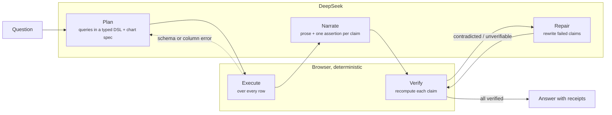

# Receipts

**Data analysis where every claim is checked.** Ask a question about a CSV. An LLM plans the analysis and explains the results, and every number it states is independently re-derived from your data before you see it.

<!-- Live demo: https://receipts-srohrer.vercel.app  (update after deploying) -->

LLMs are good at deciding *what* to compute and at explaining results. They are bad at arithmetic, and they state wrong numbers with total confidence. Receipts splits those jobs. The model never computes anything itself: it writes a plan, a deterministic engine runs it, and the model's explanation is treated as a list of claims to prove.

## How it works



1. **Plan.** The model sees only the schema, a column profile and ~12 sample rows, never the dataset. It returns JSON: queries in a small declarative DSL (filters, date buckets, group-by, aggregates, computed columns, sort, limit) plus a chart spec.
2. **Execute.** Queries run in the browser against every row ([`engine.ts`](src/lib/engine.ts)). Unknown columns, non-numeric aggregates and bad chart references go back to the model as correction messages, up to 3 attempts.
3. **Narrate.** The model gets the small aggregated results and writes an answer. Every factual phrase is wrapped in a marker (`[[c1|grew 14% year over year]]`) and paired with a typed assertion, such as `pct_change`, `share`, `rank`, `ratio`, `trend`, `compare`, `value` or `count`, that points at cells of the query results.
4. **Verify.** [`verify.ts`](src/lib/verify.ts) recomputes each assertion from the full results and grades it as **verified**, **contradicted** (with the true value), or **unverifiable** (e.g. the claim references a row that doesn't exist).
5. **Repair.** If anything failed, the model gets the verifier's findings, including the true values, and rewrites the narrative. The result is verified again. You can flip between the draft and the repaired version to see exactly what changed.

Hover any underlined claim to see its proof. The chart and result tables highlight the exact cells it depends on.

## Design decisions

- **Rounding-semantics grading.** "Grew 14%" is verified iff the true value rounds to 14 at the precision the model wrote. The tolerance comes from the stated number itself (`14` → ±0.5, `14.4` → ±0.05, `1,200,000` → ±50,000) and is capped at 5% relative, so the model can't loosen its own grading by writing vaguer numbers.
- **The model never sees raw data.** Only schema, profile, samples and aggregates (≤60 rows per query) are sent. This keeps prompts O(schema) instead of O(rows), keeps a 50 MB CSV in the browser, and removes a whole class of "misread the table" hallucinations.
- **Validation-driven retries.** The schema (zod), execution errors and chart/claim reference checks all produce precise, actionable messages that go back to the model instead of failing the request.
- **Auditable queries.** Every plan is rendered as pseudo-SQL next to its result grid.
- **Shared-key safety.** Rate limiting is per IP and global per day, with Upstash Redis when configured and in-memory otherwise. The request body is size-capped, and visitors can bring their own key. It is kept in their localStorage and never logged.

## Tech

Next.js 16 (App Router) · React 19 · TypeScript · Tailwind v4 · Recharts · TanStack Virtual (virtualized grids for 7k+ rows) · Zustand · Zod · PapaParse (Web Worker parsing) · Vitest · DeepSeek (`deepseek-flash`, OpenAI-compatible streaming, JSON mode).

The API route streams model tokens to the browser as NDJSON, so the pipeline timeline, the raw model output and the per-stage token/cost readouts update live.

```
src/lib/
  dsl.ts         the model↔app contract (zod schemas for plans, claims, checks)
  engine.ts      deterministic query executor + SQL renderer
  verify.ts      claim verification with rounding-semantics tolerances
  pipeline.ts    plan → execute → narrate → verify → repair, with retries
  prompts.ts     system prompts and message builders
  csv.ts         type inference and column profiling
  server/        DeepSeek streaming client, rate limiting
src/components/  analysis card, chart with evidence highlighting, virtualized grid, …
scripts/         sample data generator, demo recorder, mock DeepSeek server
```

## Running locally

```bash
npm install
cp .env.example .env.local   # add DEEPSEEK_API_KEY, or skip it and use demo mode
npm run dev
```

With no key, the suggested questions replay saved runs through the real engine and verifier. To exercise the full live path offline, including SSE parsing, the retry loop and repair, run the bundled mock DeepSeek server:

```bash
npm run mock:deepseek   # terminal 1: answers the sample questions, first plan deliberately broken
npm run dev:mock        # terminal 2
```

Other scripts: `npm test` (engine, verifier, and every demo run end to end through the pipeline), `npm run gen:samples` (regenerates the seeded synthetic datasets), and `npm run record:demos` (captures real DeepSeek runs of every suggested question into `src/demos/recorded.json`).

## Deploying

Import the repo in Vercel and set `DEEPSEEK_API_KEY`. Optionally set `UPSTASH_REDIS_REST_URL` / `UPSTASH_REDIS_REST_TOKEN` for durable rate limits. No other configuration is needed.

## Sample data

All three datasets (SaaS metrics, coffee sales, support tickets) are synthetic, generated by a seeded script with deliberate patterns to find: a regional churn shock, a mid-year price increase, a month-long bug surge.

## License

MIT
